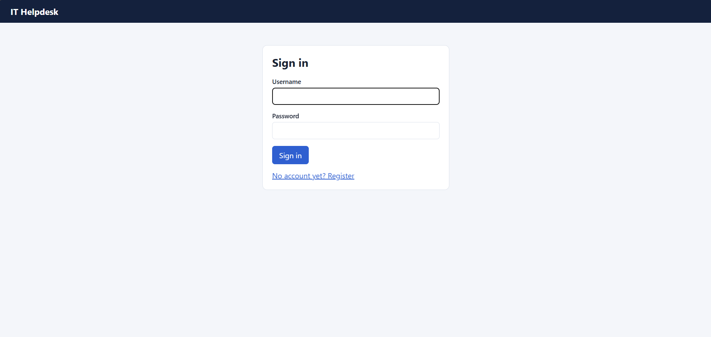
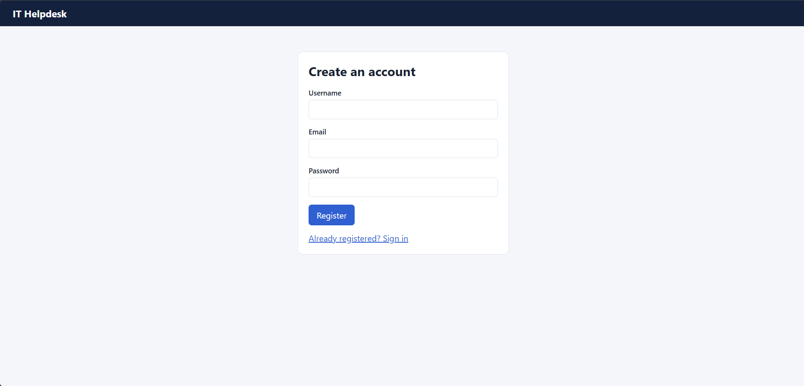
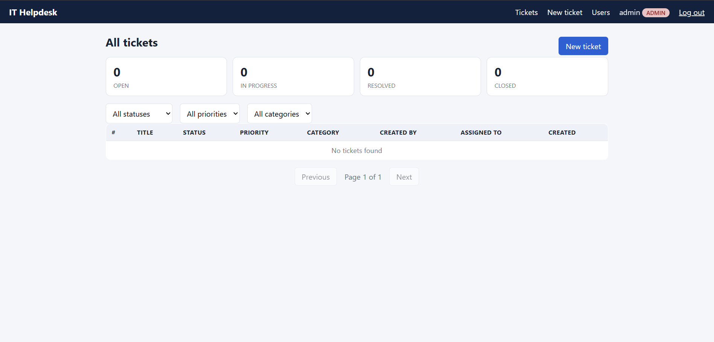
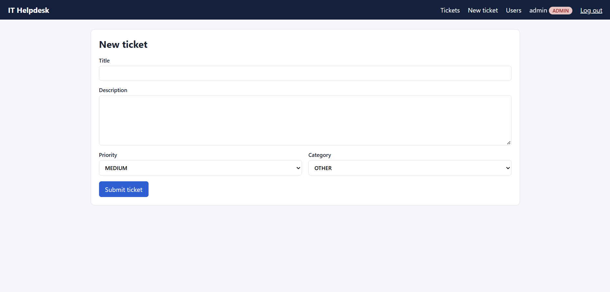
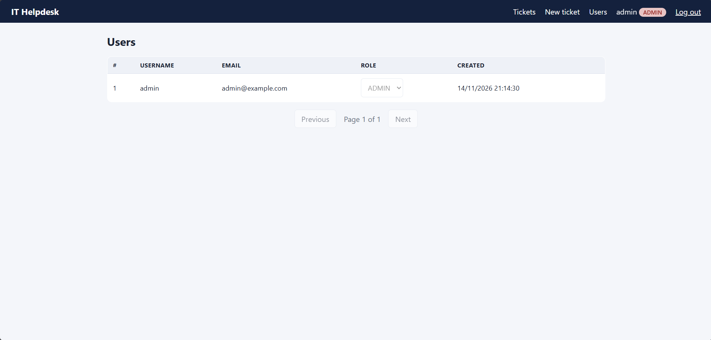

# IT Helpdesk Ticket Management System

A full-stack application for managing IT support requests. Users can report incidents, support agents can investigate and update them, and administrators can manage users and access.

Built with Java 17, Spring Boot, Spring Security, Spring Data JPA, MySQL, React, and Vite.

## Project goals

- Centralize IT support requests in one place.
- Track ticket ownership, priority, category, assignment, and status.
- Apply role-based access to user and ticket operations.
- Provide a documented REST API and a web interface.

## Features

### Ticket workflow

- Create, view, update, and delete tickets according to the user's role.
- Set priority (`LOW`, `MEDIUM`, `HIGH`, `CRITICAL`) and category (`HARDWARE`, `SOFTWARE`, `NETWORK`, `ACCOUNT`, `OTHER`).
- Move tickets through `OPEN`, `IN_PROGRESS`, `RESOLVED`, and `CLOSED` using the allowed status transitions.
- Assign tickets to support staff and add comments to ticket conversations.
- Filter, sort, and paginate ticket lists.
- View ticket statistics by status.

### Roles and permissions

| Capability | USER | AGENT | ADMIN |
|---|:---:|:---:|:---:|
| Create tickets | Yes | Yes | Yes |
| View own tickets | Yes | Yes | Yes |
| View all tickets | No | Yes | Yes |
| Update accessible tickets | Own only | Yes | Yes |
| Add comments | Own tickets | Yes | Yes |
| Change status or assign tickets | No | Yes | Yes |
| View statistics | No | Yes | Yes |
| Delete tickets | No | No | Yes |
| Manage users and roles | No | No | Yes |

Public registration creates a `USER` account. An administrator can promote users to `AGENT` or `ADMIN`.

## Screenshots

### Sign in and registration





### Ticket dashboard



### Create a ticket



### Administrator user management



## Technology stack

| Layer | Technologies |
|---|---|
| Backend | Java 17, Spring Boot 3.3.5, Spring Web, Spring Validation |
| Security | Spring Security, BCrypt, role-based authorization |
| Persistence | Spring Data JPA, Hibernate, MySQL 8 |
| Frontend | React 18, React Router 6, Vite |
| API documentation | Springdoc OpenAPI / Swagger UI |
| Tests | JUnit 5, Spring Boot Test, MockMvc, H2 |
| Build and local database | Maven, npm, Docker Compose |

## Architecture

```text
React web app (Vite)
        | HTTP /api
        v
Spring Boot REST API
  Controllers -> Services -> Repositories
        | Spring Data JPA
        v
      MySQL

Integration tests use an in-memory H2 database.
```

The domain class diagram is available at [docs/architecture/class-diagram.svg](docs/architecture/class-diagram.svg).

## Project structure

```text
src/main/java/com/helpdesk/   Backend application
  config/                      Configuration and initial administrator
  controller/                  REST endpoints
  dto/                         Request and response objects
  entity/                      JPA entities and enums
  exception/                   API and business exceptions
  repository/                  Data access
  security/                    User authentication
  service/                     Business rules
src/main/resources/            Backend configuration
src/test/                      Backend integration tests
frontend/                      React application
  src/pages/                   Application pages
  src/api.js                   API client
  src/auth.jsx                 Authentication state
  package.json                 Frontend scripts and dependencies
docs/                          Diagrams and screenshots
pom.xml                        Maven configuration
docker-compose.yml             Local MySQL service
```

## Requirements

- JDK 17 or later
- Maven 3.9 or later
- Node.js and npm
- Docker with Docker Compose, or a local MySQL 8 server

## Run locally

### 1. Configure and start MySQL

Copy `.env.example` to `.env`, then change the example database and root passwords. The `.env` file is used by Docker Compose and should not be committed.

```bash
docker compose up -d
docker compose ps
```

### 2. Configure and start the backend

The backend reads its configuration from environment variables. Set the same database values used in `.env`, along with a strong initial administrator password. The password must contain at least 12 characters, including uppercase and lowercase letters, a digit, and a symbol.

PowerShell:

```powershell
$env:DB_USERNAME="helpdesk"
$env:DB_PASSWORD="your-db-password"
$env:ADMIN_USERNAME="admin"
$env:ADMIN_EMAIL="admin@example.com"
$env:ADMIN_PASSWORD="ChangeThisToAStrongPassword!"
mvn spring-boot:run
```

Linux or macOS:

```bash
export DB_USERNAME=helpdesk
export DB_PASSWORD='your-db-password'
export ADMIN_USERNAME=admin
export ADMIN_EMAIL=admin@example.com
export ADMIN_PASSWORD='ChangeThisToAStrongPassword!'
mvn spring-boot:run
```

The API starts at `http://localhost:8080`. Swagger UI is at `http://localhost:8080/swagger-ui.html`.

The initial administrator is created only if the database does not already contain an `ADMIN` account.

### 3. Start the frontend

In a second terminal:

```bash
cd frontend
npm install
npm run dev
```

Open `http://localhost:5173`. Vite proxies `/api` requests to the backend at `http://localhost:8080`.

To create a frontend production build:

```bash
npm run build
```

The generated files are written to `frontend/dist/`.

## REST API overview

All endpoints require authentication except public registration.

| Method | Endpoint | Access | Purpose |
|---|---|---|---|
| `POST` | `/api/auth/register` | Public | Register a `USER` |
| `GET` | `/api/users/me` | Authenticated | Get the current user |
| `GET` | `/api/users/staff` | `AGENT`, `ADMIN` | List support staff |
| `GET` | `/api/users` | `ADMIN` | List users |
| `GET` | `/api/users/{id}` | `ADMIN` | Get a user |
| `PUT` | `/api/users/{id}/role` | `ADMIN` | Change a user's role |
| `DELETE` | `/api/users/{id}` | `ADMIN` | Delete an eligible user |
| `POST` | `/api/tickets` | Authenticated | Create a ticket |
| `GET` | `/api/tickets` | Authenticated | List and filter tickets |
| `GET` | `/api/tickets/{id}` | Owner, `AGENT`, `ADMIN` | Get ticket details |
| `PUT` | `/api/tickets/{id}` | Owner, `AGENT`, `ADMIN` | Update a ticket |
| `PATCH` | `/api/tickets/{id}/status` | `AGENT`, `ADMIN` | Change ticket status |
| `PATCH` | `/api/tickets/{id}/assignee` | `AGENT`, `ADMIN` | Assign a ticket |
| `DELETE` | `/api/tickets/{id}` | `ADMIN` | Delete a ticket |
| `GET` | `/api/tickets/stats` | `AGENT`, `ADMIN` | View ticket statistics |
| `GET` | `/api/tickets/{id}/comments` | Owner, `AGENT`, `ADMIN` | List comments |
| `POST` | `/api/tickets/{id}/comments` | Owner, `AGENT`, `ADMIN` | Add a comment |

Ticket lists support `status`, `priority`, and `category` filters, plus Spring Data pagination and sorting. For example:

```http
GET /api/tickets?status=OPEN&priority=HIGH&page=0&size=10&sort=createdAt,desc
```

## Tests and continuous integration

Run the backend integration tests from the project root:

```bash
mvn test
```

The tests use MockMvc and an in-memory H2 database, so MySQL is not required to run them. The GitHub Actions workflow also runs backend tests and builds the frontend on pushes and pull requests.

## Security notes

- Passwords are stored using BCrypt hashing.
- Ticket ownership is checked on the server, in addition to role-based endpoint rules.
- HTTP Basic authentication is intended for local development and must only be used over HTTPS outside a local environment.
- Keep `.env` and all real credentials out of source control. Review the authentication approach before any public deployment.

## Current limitations and possible next steps

- Frontend automated tests are not included yet.
- Database schema migrations with Flyway are not included yet.
- File attachments, email notifications, and SLA tracking could be added in a future version.
- Production deployment instructions are not included yet.

## Author

**DHIA**

- GitHub: [dhialaghmari](https://github.com/dhialaghmari)
- LinkedIn: [dhiabenlaghmari](https://www.linkedin.com/in/dhiabenlaghmari/)

---

This project demonstrates full-stack web development, REST API design, database management, and application security.

